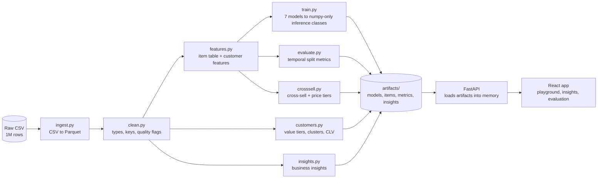
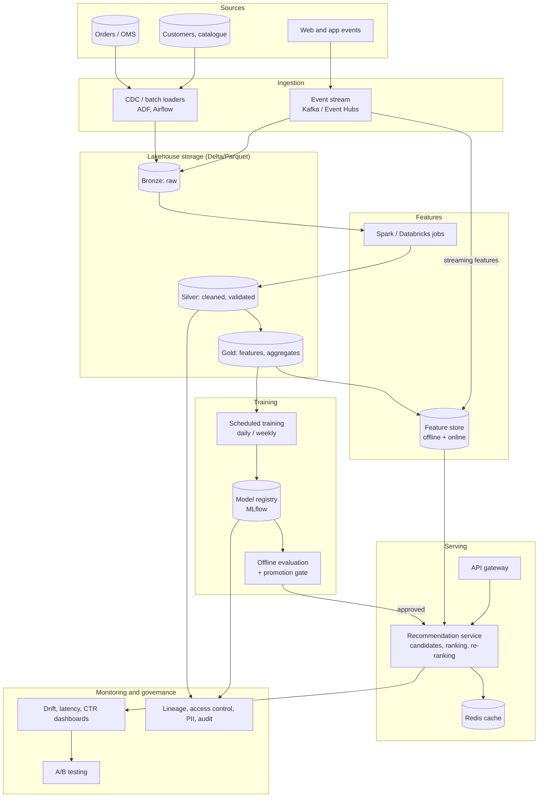
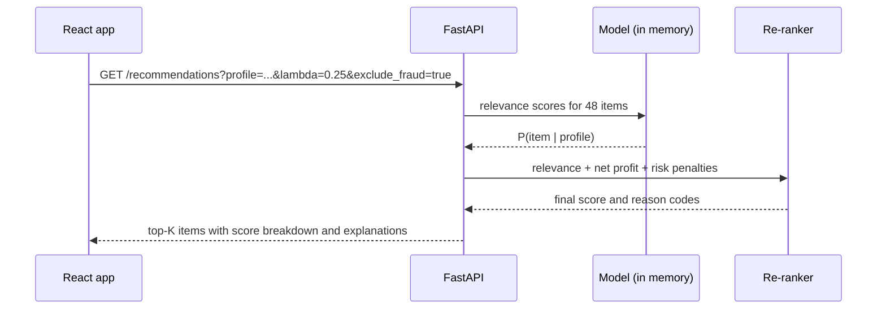

# Phase 5: Solution Architecture

**Status:** Done (design). The "built" column describes what exists in this repository. The "production" column is the scalable design.
**Scope:** ingestion, storage, feature engineering, model training, recommendation serving, monitoring and governance, plus the bonus topics (real-time, profit-aware ranking, sentiment, fraud-aware filtering, GenAI explanations).

## 1. Design principles

1. **Train offline, serve small.** Heavy work (1M rows, model fitting) runs in batch. The serving layer loads a few MB of precomputed artifacts and ranks in memory.
2. **Relevance and business value are separate layers.** A relevance model produces probabilities. A re-ranker applies business objectives (profit, risk) with weights that can change without retraining.
3. **Honest evaluation.** Every model is compared against popularity and random on a temporal split. Gains must beat the noise.
4. **Zero-cost demo, cloud-ready design.** Every demo component has a production equivalent (section 3).

## 2. Architecture as built (this repository)

## 3. Production architecture (scalable design)

### 3.1 Component table

| Area | Built in this repo | Production design | Why |
|---|---|---|---|
| **Data ingestion** | `ingest.py`: CSV to Parquet (391 MB to 81 MB) | CDC and batch loaders (Azure Data Factory or Airflow) for orders, customers and catalogue. Kafka or Event Hubs for clickstream. | Decouples sources from analytics. Streaming allows near-real-time features. |
| **Data storage** | Parquet files in `data/` and `artifacts/` | Lakehouse with **bronze** (raw), **silver** (cleaned, validated) and **gold** (features, aggregates) layers on object storage with Delta tables. A warehouse or BI layer sits on top of gold. | Cheap, scalable, and reprocessable from raw. |
| **Data quality** | `clean.py` flags: duplicates, ID reuse, status conflicts (23%) | Quality rules as pipeline gates (Great Expectations or Delta constraints). Failing batches are quarantined and alert owners. | The 23% status-conflict rate shows this data needs enforced contracts. |
| **Feature engineering** | `features.py`: 16 customer/context features, 48-row item table | Spark jobs write to a **feature store** (for example Feast) with offline and online views so training and serving use identical features. | Prevents training/serving skew. |
| **Model training** | `train.py`: 7 models, each under 40 KB | Scheduled training with MLflow tracking, a temporal-split evaluation gate, and a model registry. A model is promoted only if it beats the baseline on hit rate **and** profit. | Stops regressions reaching production. |
| **Serving** | FastAPI loads artifacts once and re-ranks in memory | Candidate generation (ANN index such as FAISS for large catalogues) then ranking then business re-ranking, behind a gateway with a Redis cache. | Millisecond latency at scale. The catalogue is only 48 items here, so scoring all items is exact and cheap. |
| **Monitoring** | `metrics.json` and `/models/metrics` | Data drift (PSI on features), prediction drift, latency/error SLOs, business KPIs (CTR, conversion, profit per recommendation). | Detects silent degradation. |
| **Governance** | Documented | PII minimization (the dataset has names and demographics, which should be pseudonymized), lineage, role-based access, audit logs, GDPR delete/opt-out, fairness and diversity checks. | Required for customer data in the EU, UK and US (all in the dataset). |

## 4. Recommendation serving flow

**Re-ranking formula** (implemented in `rec.models.business_rerank`):

`final = (1 − λ) · relevance + λ · net_profit_per_order − risk_penalty`

λ is user-controlled. At λ = 0.25 the offline evaluation (Phase 2) gave +22% profit captured per customer at the same hit rate.

## 5. Cold start and data limits

- **Every customer is cold-start** in this dataset (one order each), so recommendations use profile and context features plus popularity (the hybrid blend).
- In production, repeat customers would enable collaborative filtering. The architecture keeps a slot for it: an ALS or two-tower candidate generator whose scores feed the same re-ranker.
- The model interface (`score(df) → matrix`) is the same for all models, so new algorithms plug in without changing the API.

## 6. Bonus challenges

| Bonus | Approach | Status |
|---|---|---|
| **Profit-aware ranking** | λ re-ranker on net profit per order | Built (`business_rerank`, API parameter, UI slider) |
| **Fraud-aware filtering** | Per-order fraud score threshold and an item-level penalty | Built as an optional filter in the API and UI. Phase 4 shows the score is not a validated predictor, so it is a policy control. |
| **Sentiment-augmented** | Item positive-sentiment share as a re-ranking feature | Built as an optional feature. Sentiment is a deterministic function of rating in this data, so it adds no extra information. |
| **GenAI explanations** | Template reason codes ("Top profit in your price tier", "Complements your basket category") | Built as templates. An LLM rewrite is a drop-in extension, off by default to avoid sending customer data to a third party. |
| **Real-time architecture** | Stream, update online features, rank on request. A session-based model for anonymous visitors. | Design only (section 3). The serving flow above is already request-time. |

## 7. Scaling and cost notes

- **Today:** 1M rows trains in minutes on one machine, and the served artifacts are under 100 KB for the models and a few MB for the insights.
- **At 100× scale:** the batch layer moves to Spark. Serving stays cheap because per-customer candidate lists can be precomputed and cached, or scored on demand against the ANN index.
- **Free-tier deployment:** the API runs as a native Python web service (no Docker) with no database. The frontend is a static site. See [phase-8-deployment.md](phase-8-deployment.md).

## 8. Risks and mitigations

| Risk | Mitigation |
|---|---|
| Training/serving skew | Single feature definition (`features.py` now, a feature store later). |
| Metric gaming (recommend only expensive items) | λ trade-off is explicit. Hit rate and profit are both reported, and a promotion gate checks both. |
| Feedback loops (popular items get more exposure) | Coverage and diversity metrics, and exploration slots (not built). |
| PII exposure | Pseudonymize names. Serve only the features the model needs. |
| Data contract violations | Quality gates in the silver layer (see section 3.1). |

## 9. Problems encountered and fixes

| Problem | Fix |
|---|---|
| Typical designs assume a CF-based recommender, but the data supports none | The architecture keeps a candidate-generation slot for CF while the built system is profile-based, and says so explicitly. |
| Free-tier limits rule out a database and feature store | Precomputed artifacts loaded into memory, with the production equivalent documented. |

## 10. Next

The FastAPI service, then the React app and deployment (see phases 6 to 8).
